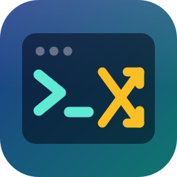
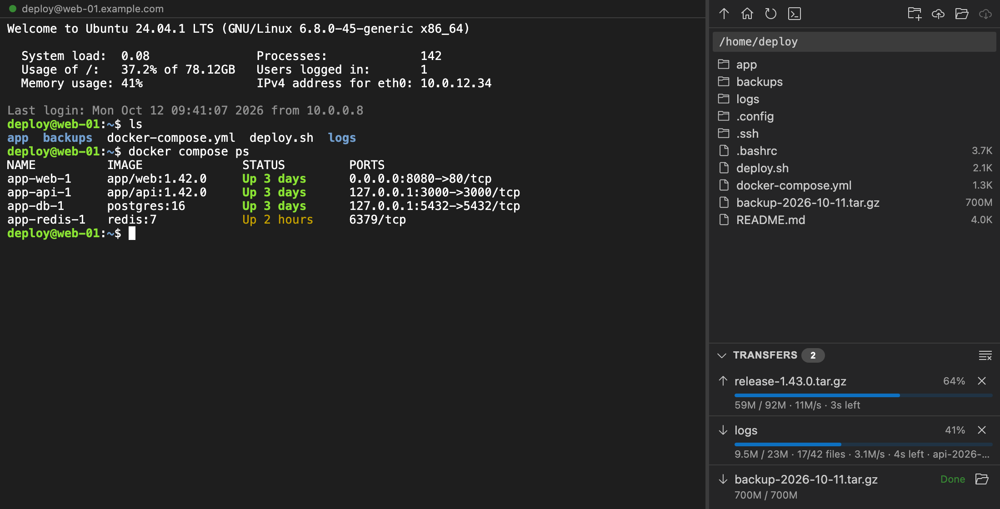
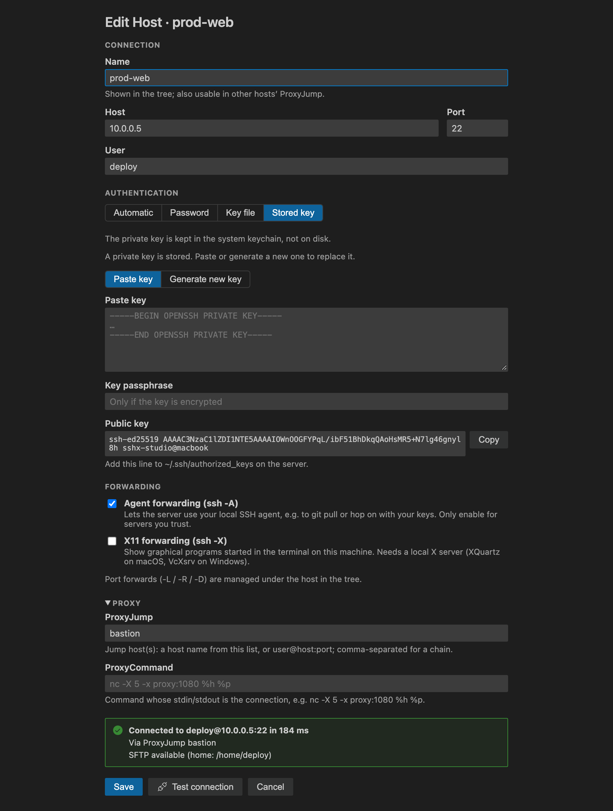

<p align="center">
  
</p>

<h1 align="center">SSHX Studio</h1>

<p align="center">
  SSH terminal, SFTP file manager and port forwarding — side by side in one VS Code tab.
</p>

<p align="center">
  <a href="https://github.com/fqix/sshx-studio/actions/workflows/ci.yml"></a>
  <a href="https://marketplace.visualstudio.com/items?itemName=fqix.sshx-studio"></a>
  <a href="https://open-vsx.org/extension/fqix/sshx-studio"></a>
  <a href="LICENSE"></a>
</p>

<p align="center">
  <b>English</b> · <a href="README.zh-CN.md">简体中文</a>
</p>



Remote - SSH turns VS Code into a remote workspace. Often you don't want that — you just need a shell on a server, its files, and a tunnel to the database behind it, next to the project you already have open. That's what SSHX Studio is for.

## Features

**Terminal and files together**
- A full xterm.js terminal and an SFTP file browser in the same tab, with a resizable split.
- Find in the terminal (⌘F / Ctrl+F), with case, whole-word and regex options.
- Several terminals per tab on one connection, or duplicate the session into a new tab.
- Browse, rename, delete, create folders, `cd` the terminal into any folder.
- Optional local pane beside the remote one: drag files between them to upload or download.
- Double-click a file to edit it in VS Code — saving uploads it back.
- Upload by dialog, drag and drop, or **right-click in the Explorer → Upload to SSH Host…**

**Transfers you can see**
- A progress bar per file or folder, with speed, time left and file count.
- Up to three transfers in parallel, each on its own SFTP channel, so browsing never stalls.
- Pause and resume anytime; a transfer interrupted by a dropped connection picks up where it stopped after reconnecting.
- Cancel anytime; partial files are cleaned up.

**Hosts and credentials**
- Imports your `~/.ssh/config` on first run (including `Include`, wildcards, `ProxyJump`, `LocalForward`, …). Your config file is never modified.
- Add and edit hosts in a form, with **Test connection** before saving.
- Organize hosts into nested groups; drag hosts between them.
- Authenticate with your SSH agent, a key file, a password, or a key kept in the system credential store — paste one or generate an Ed25519 / RSA key pair.
- Passwords and keys live in the system credential store (macOS Keychain, Windows Credential Manager, libsecret on Linux), never in plain files.

**Forwarding**
- Port forwards per host, written the way you'd pass them to `ssh`: `-L` local, `-R` remote and `-D` dynamic (SOCKS5 / SOCKS4a). Start, stop, or auto-start them from the tree.
- Agent forwarding (`-A`) and X11 forwarding (`-X`), with OpenSSH-style cookie spoofing.

**Connectivity**
- `ProxyJump` chains and `ProxyCommand` (e.g. `nc`, `cloudflared access ssh`).
- `known_hosts` verification, including hashed entries and `StrictHostKeyChecking`.

**Runs everywhere**
- One extension for macOS, Linux (glibc and musl) and Windows, on x64 and arm64.
- English and Simplified Chinese.

<p align="center">
  
</p>

## Installation

- **VS Code Marketplace** — search for “SSHX Studio” in the Extensions view, or run:
  ```bash
  code --install-extension fqix.sshx-studio
  ```
- **Open VSX** (VSCodium, Cursor, Gitpod, …) — [open-vsx.org/extension/fqix/sshx-studio](https://open-vsx.org/extension/fqix/sshx-studio)
- **From a release** — download the `.vsix` from [GitHub Releases](https://github.com/fqix/sshx-studio/releases) and run `code --install-extension sshx-studio-<version>.vsix`.

Requires VS Code 1.101 or later. Nothing needs to be installed on the server beyond a normal SSH server with SFTP enabled.

## Getting started

1. Open **SSHX Studio** in the activity bar. Hosts from `~/.ssh/config` are imported the first time.
2. Click **＋** to add a host, or right-click one to edit it. Use **Test connection** to check the settings before saving.
3. Click the terminal icon on a host to open a session: terminal on the left, files on the right.
4. Click the ⇄ icon on a host to add a port forward. Start and stop it from the tree; right-click → **Toggle Auto-start** to bring it up whenever VS Code starts.

### Port forwarding examples

| You want to… | Type | Enter | Then |
|---|---|---|---|
| Reach a database that only the server can see | `-L` | `5433:db.internal:5432` | `psql -h localhost -p 5433` |
| Show the server a dev server running on your laptop | `-R` | `9000:localhost:3000` | on the server: `curl localhost:9000` |
| Browse the server's internal network | `-D` | `1080` | set your browser's SOCKS5 proxy to `127.0.0.1:1080` |

## Configuration

| Setting | Default | Description |
|---|---|---|
| `sshxStudio.databasePath` | `~/.sshx-studio/sshx.db` | Where hosts and port forwards are stored |
| `sshxStudio.configPath` | `~/.ssh/config` | SSH config to import from |
| `sshxStudio.terminalFontSize` | `13` | Terminal font size |

<details>
<summary>Supported <code>ssh_config</code> options</summary>

`Host`, `Match all`, `Include`, `HostName`, `Port`, `User`, `IdentityFile`, `IdentitiesOnly`, `IdentityAgent`, `ProxyJump`, `ProxyCommand`, `LocalForward`, `RemoteForward`, `DynamicForward`, `ForwardAgent`, `ForwardX11`, `StrictHostKeyChecking`, `UserKnownHostsFile`, `ConnectTimeout`, `ServerAliveInterval`, and the `%h %p %r %n %d %u` tokens. Other options are kept with the host but not used yet.

</details>

## Security and privacy

- **Credentials** — passwords, key passphrases and stored private keys are kept in VS Code's SecretStorage, which is backed by the macOS Keychain, Windows Credential Manager or libsecret. They are never written to the database or to disk. On Linux this needs a running keyring such as GNOME Keyring or KWallet; without one, VS Code falls back to weaker local encryption.
- **Host data** — host settings and port forwards are kept in a local SQLite file (`~/.sshx-studio/sshx.db`, readable only by you). Nothing is synced or uploaded.
- **Host keys** — servers are verified against your `known_hosts`. A changed key is refused. New keys are added only after you confirm, or as your `StrictHostKeyChecking` setting allows.
- **Forwarding** — agent forwarding lets the server use your keys while you're connected, so only enable it for servers you trust. With X11 forwarding, the server only ever receives a random fake cookie.
- **No telemetry.** The extension makes no network connections other than the SSH connections you open.

Found a vulnerability? Please report it privately — see [SECURITY.md](SECURITY.md).

## FAQ

<details>
<summary>How is this different from Remote - SSH?</summary>

Remote - SSH runs a VS Code server on the remote machine and opens it as your workspace. SSHX Studio leaves your workspace alone and gives you a terminal, files and tunnels for any number of servers in tabs. It needs nothing on the server beyond SSH. The two work fine together.
</details>

<details>
<summary>Does it change my <code>~/.ssh/config</code>?</summary>

No — it's only read when importing. The one file it may write to is `known_hosts`, and only after you've confirmed a new host key.
</details>

<details>
<summary>X11 forwarding doesn't work</summary>

You need a local X server: [XQuartz](https://www.xquartz.org/) on macOS (log out and back in after installing it), VcXsrv or a similar server on Windows, or any X11/XWayland session on Linux. The server must allow X11 forwarding (`X11Forwarding yes` in `sshd_config`) and have `xauth` installed.
</details>

<details>
<summary>Can I use it in VSCodium, Cursor or another VS Code fork?</summary>

Yes — install it from Open VSX or from the `.vsix` on the Releases page.
</details>

## Contributing

Bug reports, ideas and pull requests are welcome — please read [CONTRIBUTING.md](CONTRIBUTING.md) for how to build, test and submit changes. Translations are especially appreciated.

## License

[MIT](LICENSE) © fengqi
